<!-- Custom motion assets are stored in this repository. -->

  

# 👋 Hi, I'm Somyajit 

🚀 **Aspiring AI Engineer | Full Stack Developer | C++ Enthusiast | Cybersecurity Enthusiast**

I'm passionate about building intelligent software, exploring cybersecurity, and continuously learning new technologies. I'm developing hands-on skills in ethical hacking, bug bounty hunting, and Kali Linux.

  

## 🧠 Currently Learning

* Artificial Intelligence 🤖
* Machine Learning & Deep Learning 🧩
* AI Agents ⚡
* C++ & Algorithms (DSA) 💻
* Full Stack Web Development 🌐
* System Design 🏗️
* Cybersecurity & Ethical Hacking 🛡️
* Bug Bounty Hunting & Web Security 🐛
* Kali Linux & Linux Tools 🐧

## 🎯 Goals

* Build impactful AI projects 🚀
* Contribute to Open Source 🌍
* Build security skills through hands-on labs and CTFs 🚩
* Find and responsibly report vulnerabilities through bug bounty programs 🔎
* Learn something new every day 📚

> **"Learn • Build • Iterate • Repeat."** 🚀

## ⚡ Neural Lab

  

---

## 🐍 Contributions in motion

<picture>
  <source media="(prefers-color-scheme: dark)" srcset="https://raw.githubusercontent.com/LowkyFoolDev/LowkyFoolDev/refs/heads/output/github-snake-dark.svg" />
  <source media="(prefers-color-scheme: light)" srcset="https://raw.githubusercontent.com/LowkyFoolDev/LowkyFoolDev/refs/heads/output/github-snake.svg" />
  
</picture>

Refreshed daily with <a href="https://github.com/Platane/snk">Platane/snk</a> · <a href="https://github.com/LowkyFoolDev/LowkyFoolDev/actions/workflows/snake.yml">Animation workflow</a>
